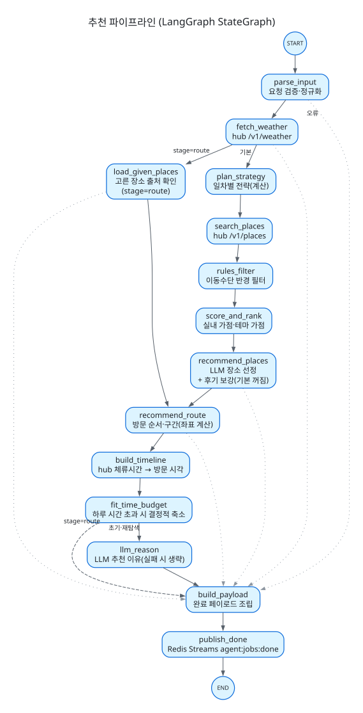
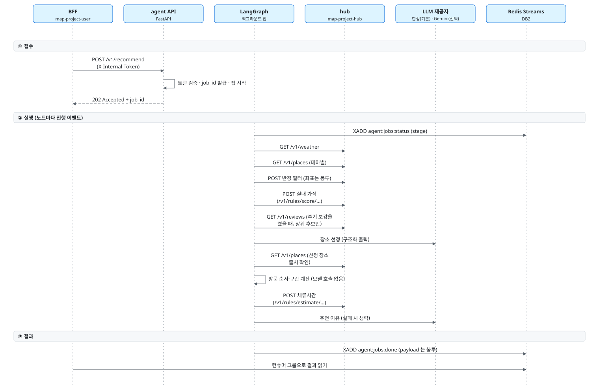

# map-project-agent

여행 조건을 받아 실제 장소 후보 안에서 일정·동선을 만드는 추천 엔진(FastAPI · LangGraph).

## 저장소 지도

MAP 는 일곱 저장소로 이루어져 있다. 전체 구조와 한 번에 실행하는 방법은 [map-project-infra](https://github.com/we-meet-trip/map-project-infra) 에서 시작한다.

| 저장소 | 역할 |
|---|---|
| [map-project-infra](https://github.com/we-meet-trip/map-project-infra) | 전체 안내, 로컬 실행 구성(Docker Compose), DB 초기화 |
| [map-project-client](https://github.com/we-meet-trip/map-project-client) | 모바일 앱(Flutter, iOS·Android) |
| [map-project-user](https://github.com/we-meet-trip/map-project-user) | 사용자 BFF(Spring Boot): 인증·일정·채팅·동의, 다른 서비스 중계 |
| **[map-project-agent](https://github.com/we-meet-trip/map-project-agent)** | **추천 에이전트(FastAPI·LangGraph): 장소·경로·일정 생성** |
| [map-project-hub](https://github.com/we-meet-trip/map-project-hub) | 외부 데이터 게이트웨이(FastAPI·PostGIS): 관광·날씨·장소·경로 |
| [map-project-yolo](https://github.com/we-meet-trip/map-project-yolo) | 비전 서비스(WebSocket, 객체 탐지 + LLM 식별) |
| [map-project-admin](https://github.com/we-meet-trip/map-project-admin) | 운영 콘솔(FastAPI·React) |

## 이름의 뜻

- `map-project` 는 MAP 프로젝트의 공개 저장소 묶음 이름이다. 일곱 저장소가 같은 접두를 쓴다.
- `agent` 는 이 서비스가 LangGraph 노드 그래프로 여러 단계(날씨 → 후보 검색 → 룰 → 선정 → 동선 → 시간표 → 설명)를 이어 추천을 만드는 에이전트라는 뜻이다.

## 개요

BFF(map-project-user)가 맡긴 추천 요청을 받아 `job_id` 를 바로 돌려주고, 그래프를 백그라운드로 돌려 결과를 Redis Streams 로 내보낸다. 장소·날씨·체류시간은 직접 갖지 않고 허브(map-project-hub)에서 얻는다. 모델은 허브의 룰을 통과한 **실측 후보 안에서 index 로만** 고르며, 장소나 좌표를 만들지 않는다. 동선과 시간표는 좌표로 계산한다.

기본 LLM 제공자는 **결정적 합성 제공자**다. 외부 키·네트워크·비용 없이 끝까지 돌고, 결과 문장마다 `[합성]` 이 붙는다. Gemini 는 쓰는 사람이 제공자를 고르고 자기 키를 넣었을 때만 부른다.

## 아키텍처

<picture>
  <source media="(prefers-color-scheme: dark)" srcset="docs/diagrams/agent-graph-dark.svg">
  
</picture>

<picture>
  <source media="(prefers-color-scheme: dark)" srcset="docs/diagrams/recommend-request-dark.svg">
  
</picture>

처리 순서·모듈·한도·보안 구성은 [docs/architecture.md](docs/architecture.md), 그림의 근거는 [docs/diagrams/CLAIMS.md](docs/diagrams/CLAIMS.md) 에 있다.

## 기능

- 초기 추천(`stage=init`): 테마별 장소 검색 → 이동수단 반경 필터 → 실내·테마 가점 랭킹 → 일차별 선정 → 동선·시간표 → 추천 이유·옷차림
- 재탐색(`stage=reexplore`): 일부 장소를 빼거나 남기고 나머지를 다시 고른다
- 동선 전용(`stage=route`): 사용자가 고른 장소로 순서·구간·시간표만 만든다(LLM 호출 0회)
- 하루 활동 시간을 넘으면 결정적으로 줄이고, 지킬 수 없으면 실패로 알린다
- 노드별 진행 이벤트(`agent:jobs:status`)
- 블로그 후기 요약 엔드포인트(단건·묶음, 기본 꺼짐)
- 서비스 사이 좌표 봉투(AES-GCM), 체크포인트 봉인, 프롬프트 인젝션 방어
- 결정적 평가 도구(`eval/`)

## 빠른 시작

### 전체를 한 번에

추천은 허브·Redis 와 함께 돌아야 한다. [map-project-infra](https://github.com/we-meet-trip/map-project-infra) 의 빠른 시작이 합성 LLM 과 허브의 시험 모드로 외부 키 없이 전체를 띄운다.

### 이 저장소만

```bash
python3.12 -m venv .venv && . .venv/bin/activate
pip install -r requirements.txt -r requirements-dev.txt
python -m pytest -q                      # 외부 호출 없이 전체 테스트

cp .env.example .env
# .env 의 MAP_PROJECT_LOCATION_WIRE_KEY 에 아래 명령의 출력을 넣는다(필수)
openssl rand -base64 32
uvicorn map_project_agent.main:app --port 8000
curl http://127.0.0.1:8000/health        # {"status":"ok","service":"agent"}
```

이 상태로 서버는 뜨지만, 추천 요청은 허브와 Redis 가 있어야 끝까지 돈다.

## 설정

모든 설정은 [`.env.example`](.env.example) 에 기본값과 설명이 있다. agent 만 읽는 값은 `AGENT_`, 다른 서비스와 같이 읽는 값은 `MAP_PROJECT_` 로 시작한다.

**`.env.example` 은 로컬 실행용 기본값이다. 외부에 열기 전에 반드시 `AGENT_AUTH_ENFORCED=true` 로 켜고 `MAP_PROJECT_INTERNAL_SERVICE_TOKEN`·`MAP_PROJECT_LOCATION_WIRE_KEY` 같은 키·토큰을 직접 만들어 채운다.**

| 묶음 | 대표 설정 | 기본 |
|---|---|---|
| LLM 제공자 | `AGENT_LLM_PROVIDER`(`fake`·`gemini`), `MAP_PROJECT_GEMINI_API_KEY`, `MAP_PROJECT_GEMINI_MODEL` | 합성(fake) |
| 연결 | `MAP_PROJECT_HUB_BASE_URL`, `MAP_PROJECT_REDIS_URL`(DB 번호를 붙이지 않는다), `MAP_PROJECT_REDIS_DB_STREAMS` | `http://hub:8000`, DB2 |
| 보안 | `MAP_PROJECT_LOCATION_WIRE_KEY`(필수), `MAP_PROJECT_INTERNAL_SERVICE_TOKEN`, `AGENT_AUTH_ENFORCED` | 인증 강제 꺼짐(로컬용) |
| 체크포인터 | `AGENT_CHECKPOINT_ENABLED`, `AGENT_DATABASE_USER`, `AGENT_CHECKPOINT_ENC_KEYS` | 꺼짐 |
| 외부 본문·기록 전송 | `AGENT_REVIEWS_ENRICH_ENABLED`, `AGENT_SUMMARY_ENABLED`, `AGENT_LANGSMITH_TRACING` | 모두 꺼짐 |
| 학습 수집 | `MAP_PROJECT_TRAINING_CAPTURE_ENABLED` | 꺼짐 |

체크포인터를 켜는 순서(역할 SQL → 마이그레이션 → 역할 SQL 재적용)는 [docs/architecture.md](docs/architecture.md#체크포인트-데이터베이스와-역할) 에 있다.

## 데이터

이 저장소에는 직접 작성한 평가 조건과 합성 테스트 값만 있다. 실행 중 지나가는 자료(장소 후보·날씨·후기)와 그 행선지, 기본 꺼짐인 전송 경로는 [docs/data.md](docs/data.md) 에 있다.

## API 와 계약

| 경로 | 설명 |
|---|---|
| `POST /v1/recommend` | 추천 접수 → 202 `{job_id}`. 결과는 Redis Streams `agent:jobs:done` |
| `POST /v1/reviews/summary`, `/v1/reviews/summary/batch` | 후기 요약(기본 꺼짐) |
| `GET /health`, `GET /health/ready`, `GET /metrics` | 상태 확인·지표 |

필드·길이 제한·실패 코드·스트림 형식은 [docs/contracts.md](docs/contracts.md) 에 있고, 모양은 `tests/test_contract_freeze.py` 가 고정한다.

## 폴더 구조

```
map-project-agent/
├── map_project_agent/
│   ├── main.py               FastAPI 앱, lifespan, 엔드포인트, 잡 실행
│   ├── agent_settings.py     환경 변수 설정
│   ├── agent_dependencies.py 클라이언트 주입 슬롯
│   ├── graph/                추천·요약 StateGraph
│   ├── nodes/                노드 함수
│   ├── clients/              hub HTTP·Redis Streams·Gemini 클라이언트
│   ├── llm/                  구조화 호출, 호출 한도기, 합성 제공자
│   ├── crypto/               좌표 봉투, 체크포인트 봉인
│   ├── security/             프롬프트 입력 정리
│   ├── schemas/              요청·응답·LLM 출력 스키마
│   ├── checkpoint_db.py      체크포인트 스키마 검증
│   └── checkpoint_migrate.py 따로 도는 마이그레이션
├── eval/                     결정적 평가 도구와 케이스
├── tests/                    오프라인 테스트
├── scripts/                  역할 SQL, 다이어그램 렌더
├── docs/                     아키텍처·계약·데이터·트러블슈팅·결정 기록·다이어그램
├── Dockerfile
├── pyproject.toml
├── requirements.txt
└── requirements-dev.txt
```

## 테스트

```bash
python -m pytest -q
```

외부 API·Redis·Postgres 없이 대역으로 돈다(테스트 429개, 네트워크를 막은 상태에서도 통과). CI 는 Python 3.12·3.13·3.14 에서 돈다. 이미지 권한·취약점 점검은 `.github/workflows/runtime-image-audit.yml` 이 수동·PR 로 돈다.

다이어그램은 `scripts/render_diagrams.sh`(Graphviz·rsvg-convert 필요)로 원본에서 다시 만든다.

## 트러블슈팅과 교훈

[docs/troubleshooting.md](docs/troubleshooting.md) 에 15건이 있다. 예: 구조화 응답이 thinking 토큰 때문에 잘리던 문제, DB 재기동 뒤 끊긴 연결로 추천이 연달아 실패하던 문제, 봉투를 연 값이 검증 없이 그래프로 들어가던 문제, `REDIS_URL` 의 DB 번호가 스트림 DB 를 덮던 문제. 설계 결정은 [docs/decisions](docs/decisions/README.md) 에 있다.

## 한계

- 합성 제공자의 결과는 후보 순위를 따른 틀 문장이라 추천 품질을 대표하지 않는다. 실제 품질은 Gemini 제공자로 확인해야 한다.
- 장소·날씨는 허브에 의존한다. 이 저장소만으로는 추천이 끝까지 돌지 않는다.
- 구간 거리·시간은 좌표 기반 추정이다.
- hub 호출 제한(5초)이 hub 의 외부 장소 검색 한 건 제한과 같아, 외부 검색이 느리면 agent 가 먼저 끊고 후보 없이 저하된다. 필요하면 `AGENT_HUB_TIMEOUT_SECONDS` 를 늘린다.
- 사용자 동의 확인은 BFF 가 한다. agent 는 동의를 검사하지 않으므로 단독으로 외부에 열지 않는다.
- 좌표 봉투 열쇠는 user·agent·hub 가 같은 값을 가져야 한다. 한쪽만 바꾸면 좌표가 오가는 요청이 모두 거절된다.
- 평가 도구는 외부 응답을 녹화하지 않아, 같은 케이스라도 외부 응답이 바뀌면 점수가 흔들린다.

## 감사 표시

- 다이어그램 글꼴: [Pretendard](https://github.com/orioncactus/pretendard)(SIL Open Font License 1.1). 글꼴 파일은 저장소에 넣지 않는다.
- 주요 라이브러리: FastAPI, LangGraph, Pydantic, google-genai, redis-py, psycopg, cryptography — 각자의 라이선스를 따른다.

## 고지

- 이 저장소는 교육·학습 목적으로 공개한 코드다. 운영 중인 서비스가 아니며 지원을 약속하지 않는다.
- 이 프로젝트는 코드가 연동하는 외부 서비스·데이터 제공자(한국관광공사, 기상청, 공공데이터포털, 국토교통부, 서울특별시, 한국환경공단, 카카오, 네이버, Google, Apple, LangChain, ODsay, OpenStreetMap, Ultralytics, Wikimedia 등)와 관련이 없으며, 그들로부터 승인이나 후원을 받지 않았다. 언급한 상표와 서비스 이름은 각 소유자에게 있다.
- 저장소에는 제3자 데이터·이미지·본문을 넣지 않는다. 예외로, 이용조건을 원문으로 확인한 공공·개방 자료만 출처와 이용조건을 밝혀 담는다(`docs/data.md`). 그 밖의 외부 데이터는 각 제공자의 약관에 따라 직접 받아야 한다.
- MIT 라이선스는 이 저장소의 코드에만 적용된다. 저장소에 담은 공공·개방 자료와 외부 데이터, 모델 가중치, 폰트, 라이브러리는 각자의 이용조건·라이선스를 따른다.

## 라이선스

코드는 [MIT 라이선스](LICENSE)를 따른다. Copyright (c) The MAP Contributors. 만든 사람들은 [AUTHORS.md](AUTHORS.md) 에 있다.
