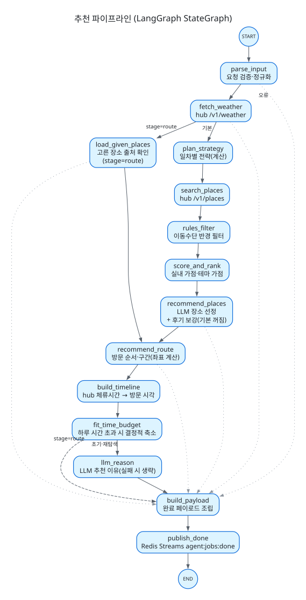

# 아키텍처

map-project-agent 는 여행 일정 추천 엔진이다. BFF(map-project-user)가 맡긴 추천 요청을 받아 LangGraph 파이프라인을 돌리고, 결과를 Redis Streams 로 내보낸다. 장소·날씨·체류시간 같은 데이터는 직접 갖지 않고 허브(map-project-hub)의 REST API 로 얻는다.

## 처리 순서

<picture>
  <source media="(prefers-color-scheme: dark)" srcset="diagrams/agent-graph-dark.svg">
  
</picture>

1. `POST /v1/recommend` 가 요청을 검증하고 `job_id` 를 발급해 202 로 바로 돌려준다. 그래프는 백그라운드 태스크로 돈다(`map_project_agent/main.py`).
2. `parse_input` → `fetch_weather`(hub `/v1/weather`) → `plan_strategy`(일차별 전략, 계산만).
3. 초기 추천·재탐색(`stage` 가 `init`·`reexplore`): `search_places`(hub `/v1/places`, 테마별 조회 후 병합) → `rules_filter`(hub 이동수단 반경 필터) → `score_and_rank`(hub 실내 가점 + 테마 가점) → `recommend_places`(LLM 이 후보 index 로만 선택).
4. 사용자가 장소를 골라 온 요청(`stage=route`): `load_given_places` 가 고른 장소의 출처를 hub 검색으로 확인한 뒤 곧장 동선 단계로 간다.
5. `recommend_route`(방문 순서·구간을 좌표로 계산, 모델 호출 없음) → `build_timeline`(hub 체류시간 → 방문 시각) → `fit_time_budget`(하루 활동 시간을 넘으면 결정적으로 줄임).
6. 초기 추천·재탐색만 `llm_reason`(추천 이유·옷차림). 실패해도 잡을 죽이지 않고 생략한다.
7. `build_payload` → `publish_done`(Redis Streams `agent:jobs:done`). 노드마다 진행 이벤트를 `agent:jobs:status` 로 낸다.

어느 노드든 `state["error"]` 를 세우면 남은 노드를 건너뛰고 실패 페이로드로 간다. 그림의 근거는 [diagrams/CLAIMS.md](diagrams/CLAIMS.md) 에 노드·엣지마다 있다.

블로그 후기 요약은 별도 그래프다(`map_project_agent/graph/summary_graph.py`): `prepare_places` → `summarize` → `collect_bullets`. `POST /v1/reviews/summary`(한 곳)·`/v1/reviews/summary/batch`(여러 곳)가 이 그래프를 부르며, 기본은 꺼져 있다(`AGENT_SUMMARY_ENABLED=false`).

## 모듈

| 경로 | 역할 |
|---|---|
| `map_project_agent/main.py` | FastAPI 앱, lifespan(설정 검사·클라이언트 생성·체크포인터), 엔드포인트, 잡 실행 |
| `map_project_agent/agent_settings.py` | 환경 변수 설정(`AGENT_`·`MAP_PROJECT_` 접두) |
| `map_project_agent/graph/` | 추천·요약 StateGraph 배선 |
| `map_project_agent/nodes/` | 노드 함수(프롬프트 조립·검증·병합) |
| `map_project_agent/clients/agent_clients.py` | hub HTTP 클라이언트, Redis Streams 발행자, Gemini 클라이언트 |
| `map_project_agent/llm/` | 구조화 호출(예산·교정 재시도), 호출 한도기, 합성 LLM 제공자, 프롬프트 JSON 직렬화 |
| `map_project_agent/crypto/` | 서비스 사이 좌표 봉투, 체크포인트 봉인 |
| `map_project_agent/security/sanitize.py` | 프롬프트에 싣는 외부 문자열 정리(인젝션 방어) |
| `map_project_agent/schemas/agent_schemas.py` | 요청·응답·LLM 출력 스키마 |
| `map_project_agent/checkpoint_db.py`, `checkpoint_migrate.py` | 체크포인트 스키마 검증, 따로 도는 마이그레이션 |
| `eval/` | 저장한 결과를 결정적으로 채점하는 평가 도구(망 호출 없음, 수집기 제외) |

## LLM 제공자

- 기본은 합성 제공자(`AGENT_LLM_PROVIDER=fake`, `map_project_agent/llm/fake_client.py`)다. 프롬프트의 데이터 태그만 읽어 후보 앞에서부터 하루 세 곳씩 고르고, 이유·옷차림·요약은 틀 문장으로 채운다. 같은 입력이면 같은 결과이며 문장마다 `[합성]` 이 붙는다. 외부 호출·비용이 없다.
- `AGENT_LLM_PROVIDER=gemini` 로 고르고 `MAP_PROJECT_GEMINI_API_KEY` 를 넣었을 때만 Gemini 를 부른다. 이때만 키를 검사하고 호출 한도기를 띄운다.
- 합성 제공자일 때는 hub 시험 모드의 스텁 후보(content_id 에 `stub`)도 장소로 받는다. 빠른 시작이 외부 키 없이 끝까지 돌게 하기 위해서다. Gemini 제공자에서는 스텁 후보를 받지 않는다.
- 모든 LLM 호출은 `call_structured` 한 관문을 지난다(장소 선정·추천 이유·후기 요약 세 곳).

## 외부 의존성

| 대상 | 용도 | 기본 동작 |
|---|---|---|
| map-project-hub | 날씨·장소 검색·룰(반경·실내 가점·체류시간)·후기 | 필수 |
| Redis | Streams 발행(DB2), Gemini 호출 한도(DB3) | 필수(한도는 gemini 일 때만) |
| PostgreSQL | LangGraph 체크포인터(`langgraph` 스키마) | `AGENT_CHECKPOINT_ENABLED=false` 면 쓰지 않음 |
| Gemini API | 장소 선정·추천 이유·후기 요약 | 제공자를 gemini 로 고를 때만 |
| LangSmith | 실행 기록 | `AGENT_LANGSMITH_TRACING=false`(기본) 면 보내지 않음 |

## 타임아웃과 한도

| 항목 | 기본값 | 설정 |
|---|---|---|
| 추천 요청당 LLM 호출 | 3회(선정 1 + 이유 1 + 교정 재시도 여유 1) | `AGENT_GEMINI_MAX_CALLS_PER_REQUEST` |
| 후기 요약 요청당 LLM 호출 | 2회 | `AGENT_SUMMARY_MAX_LLM_CALLS` |
| Gemini 분당·일일 한도 | RPM 10, 자체 일일 상한 200(KST 자정 리셋) | `AGENT_GEMINI_RPM_LIMIT`, `MAP_PROJECT_GEMINI_RPD_CAP` |
| Gemini 전송 재시도 | 3회, 503·500 만(429 제외), 시도별 30초 | `AGENT_GEMINI_RETRY_*`, `AGENT_GEMINI_HTTP_TIMEOUT_SECONDS` |
| Gemini 호출 1건 | 100초 | `AGENT_GEMINI_TIMEOUT_SECONDS` |
| 잡 1건 | 300초 | `AGENT_JOB_TIMEOUT_SECONDS` |
| 종료 시 진행 중 잡 대기 | 310초 | `AGENT_SHUTDOWN_GRACE_SECONDS` |
| hub HTTP | 5초(hub 의 외부 장소 검색 한 건 제한과 같다 — 외부 검색이 느리면 agent 가 먼저 끊고 저하 경로로 간다) | `AGENT_HUB_TIMEOUT_SECONDS` |
| hub 룰 요청 한 번의 항목 수 | 100(넘으면 나눠 보내고 합친다) | `HUB_RULES_MAX_ITEMS`(코드 상수) |
| 선정 프롬프트 후보 수 | max(40, 여행일수 × 12) | `AGENT_CANDIDATES_MAX_BASE`, `AGENT_CANDIDATES_PER_DAY` |

## 보안 구성

- **내부 토큰**: `MAP_PROJECT_INTERNAL_SERVICE_TOKEN` 이 있으면 인바운드 `X-Internal-Token` 을 검사하고 hub 호출에 붙인다. **`AGENT_AUTH_ENFORCED` 는 로컬 실행용으로 기본 false 다. 외부에 열기 전에 반드시 true 로 켜고 토큰을 채운다.**
- **좌표 봉투**: 서비스 사이 좌표는 늘 AES-GCM 봉투(`v1.<난수>.<암호문>`, AAD `map|loc|v1`)로 오간다. hub 반경 필터 요청, 완료 스트림 본문, BFF 가 보내는 고른 장소가 대상이다. 열쇠 `MAP_PROJECT_LOCATION_WIRE_KEY` 는 필수이며 hub·BFF 와 같은 값이어야 한다. 없으면 부팅을 멈춘다(`openssl rand -base64 32`).
- **체크포인트 봉인**: 체크포인터를 켜면 대화 상태를 저장 전에 봉한다(`AGENT_CHECKPOINT_ENC_KEYS` 의 `kid:base64` 목록, `AGENT_CHECKPOINT_ENC_ACTIVE_KID`). 봉투 열쇠와 같은 값이면 부팅을 거부한다.
- **프롬프트 인젝션**: 외부 문자열(장소 이름·후기)은 정리한 뒤 데이터 태그 안에만 싣고, 시스템 지시에는 섞지 않는다.

## 체크포인트 데이터베이스와 역할

체크포인터는 기본으로 꺼져 있다. 켜려면 다음 순서를 따른다.

1. 운영자 계정으로 `scripts/database-roles.sql` 을 실행한다. 세 역할을 만든다: `map_agent_owner`(NOLOGIN, 스키마 소유), `map_agent_migrator`(owner 의 구성원, 마이그레이션 전용), `map_agent_runtime`(런타임 전용). 비밀번호는 이 SQL 이 다루지 않으므로 따로 정한다.
2. 마이그레이션을 따로 실행한다: `python -m map_project_agent.checkpoint_migrate`. 환경 변수는 `AGENT_CHECKPOINT_MIGRATION_DSN`(migrator 의 libpq DSN)과 선택 `AGENT_LANGGRAPH_SCHEMA` 만 넣는다. 런타임 비밀번호(`AGENT_DATABASE_PASSWORD`)가 보이면 거부한다. 고정한 SDK 마이그레이션만 순서대로 적용하고, 동시 실행은 advisory lock 으로 막는다.
3. 같은 SQL 을 한 번 더 실행한다. 런타임 권한(SELECT/INSERT/UPDATE/DELETE)은 테이블이 있을 때만 주고, 새 객체는 기본 권한으로 막혀 있기 때문이다.
4. 런타임은 `AGENT_DATABASE_USER=map_agent_runtime` 으로만 붙는다. 부팅 때 SELECT 만으로 마이그레이션 판·테이블·인덱스·역할 권한을 검사하고, 다른 역할이거나 권한이 넓으면 멈춘다. 런타임은 `setup()` 을 부르지 않는다.
