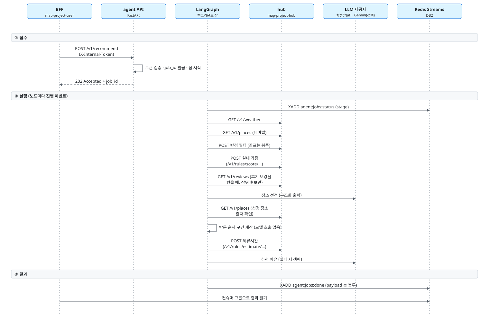

# 계약

요청·응답의 모양은 `tests/test_contract_freeze.py` 가 고정한다(필드 이름·타입·필수 여부). 계약을 바꿀 때는 그 골든을 함께 고친다. 소유 관계: 아래 경로와 스트림은 이 레포가 정의하고, BFF(map-project-user)가 소비한다.

<picture>
  <source media="(prefers-color-scheme: dark)" srcset="diagrams/recommend-request-dark.svg">
  
</picture>

## 공통

- 내부 토큰: 헤더 `X-Internal-Token`. 토큰이 설정된 배포에서 없거나 다르면 401 `invalid internal token`.
- 좌표가 담긴 값은 늘 봉투 문자열(`v1.<난수>.<암호문+검증표>`, URL 안전 base64, AAD `map|loc|v1`)이다. 만든 지 300초가 지난 봉투는 열지 않는다.

## `POST /v1/recommend` → 202

요청 본문(`AgentRequest`):

| 필드 | 타입 | 필수 | 설명 |
|---|---|---|---|
| `date` | `{date_start, date_end, time_start, time_end}` | 예 | 여행 기간과 하루 활동 시간 |
| `province`, `city` | 문자열 | 예 | 지역 |
| `mobility` | `walk`·`transit`·`car`·`bicycle`·`scooter` | 아니오 | 이동수단(반경 필터 기준) |
| `theme` | 문자열 목록 | 아니오 | 테마(테마별로 따로 검색해 합친다) |
| `budget` | 정수 | 아니오 | 예산 |
| `stage` | `init`(기본)·`reexplore`·`route` | 아니오 | 초기 추천 / 일부를 빼고 다시 뽑기 / 고른 장소로 동선만 |
| `exclude` | content_id 목록 | 아니오 | 재탐색에서 다시 추천하지 않을 장소 |
| `loc` | 봉투 문자열(최대 8192자) | stage 에 따라 | 고른 장소(`{"places": [...]}`, 1~10곳)를 담은 봉투. `route` 와 남길 장소가 있는 `reexplore` 에서 쓴다 |
| `places` | 장소 목록 | — | 평문으로는 받지 않는다. `loc` 없이 `places` 만 오면 400 `invalid location` |
| `optimize` | 불리언 | 아니오 | `route` 에서 방문 순서를 최적화할지(기본은 입력 순서 유지) |
| `schedule_id` | 문자열 | 아니오 | BFF 쪽 일정 식별자 |

응답(`AgentJobAccepted`): `{"job_id": "...", "status": "in_progress", "retry_after_seconds": N}`. 결과는 아래 스트림으로만 나간다(조회 경로 없음). 그래프가 준비되지 않았으면 503 `graph not ready`.

## Redis Streams

| 스트림 | DB | 필드 | 내용 |
|---|---|---|---|
| `agent:jobs:status` | 2 | `job_id`, `stage` | 노드 진입마다 진행 이벤트(best-effort) |
| `agent:jobs:done` | 2 | `job_id`, `status`, `payload`, (`training`) | 잡 결과. `payload` 는 아래 JSON 을 `{"payload": ...}` 로 감싼 봉투. `training` 은 학습 수집이 켜졌을 때만 |

스트림 이름·길이는 `MAP_PROJECT_STREAM_NAME`·`MAP_PROJECT_STREAM_MAXLEN`(done), `AGENT_STATUS_STREAM_NAME`·`AGENT_STATUS_STREAM_MAXLEN`(status) 로 바꿀 수 있다. DB 번호(`MAP_PROJECT_REDIS_DB_STREAMS`)는 BFF 컨슈머와 같아야 한다.

완료 페이로드(`JobDonePayload`):

| 필드 | 설명 |
|---|---|
| `job_id`, `status` | `done` 또는 `failed` |
| `places` | 장소 목록: `place_id`, `day`, `name`, `address`, `lat`, `lng`, `recommended_visit_time`, 출처(`content_id`, `source`, `grounded`), 분류, 시간축(`stay_minutes`, `visit_start`, `visit_end`, `stay_source`), `reason`, `bullets` 등 |
| `visit_order`, `legs` | 방문 순서와 구간(`from`, `to`, `mode`, `estimated_distance_km`, `estimated_duration_min`) |
| `clothing` | 옷차림 안내 |
| `timeline_status` | `ok`·`trimmed`·`unverified` |
| `warnings` | 날씨 결측 같은 안내 |
| `error`, `code`, `retryable` | 실패일 때 |

합성 제공자(기본)로 만든 결과는 `reason`·`clothing`·`recommended_visit_time` 이 `[합성]` 으로 시작한다.

### 실패 코드

| `code` | 뜻 | `retryable` |
|---|---|---|
| `invalid_request` | 요청 조건이 맞지 않음(기간·장소 수 등) | false |
| `no_matching_places` | 조건에 맞는 실측 후보가 없음 | false |
| `selection_invalid` | 모델 출력이 형식·검증을 통과하지 못함, 또는 예산 소진 | false |
| `quota_exceeded` | 호출 한도 초과(분당·일일, hub 429) | false |
| `upstream_unavailable` | hub·외부 서비스 오류·시간 초과 | 대체로 true |
| `generation_timeout` | 잡 전체 시간 초과 | true |
| `generation_failed` | 그 밖의 실패 | false |

모델이나 외부 서비스의 원문 메시지는 결과에 싣지 않는다(`map_project_agent/errors.py`).

## 학습 신호(`training` 필드)

`MAP_PROJECT_TRAINING_CAPTURE_ENABLED=true` 일 때만 싣는다(기본 꺼짐). `schema_version` 은 `"1.0.0"` 이며, 선택 경로·노출된 후보(순위 포함)·고른 content_id·요청 조건·랭킹 설정이 들어간다. 사람이 고른 장소나 동의 조건은 BFF 가 판단한다.

## 블로그 후기 요약

기본 꺼짐(`AGENT_SUMMARY_ENABLED=false`). 꺼져 있으면 모델을 부르지 않고 빈 결과를 준다.

| 경로 | 요청 | 응답 |
|---|---|---|
| `POST /v1/reviews/summary` | `place_name`(1~80자), `category`(≤80자), `reviews`(1~7건: `title` ≤200자, `description` 1~500자) | `{"bullets": [두 줄 이하]}` |
| `POST /v1/reviews/summary/batch` | `places`: 위 항목 1~7개 | `{"results": [{"index", "bullets"}]}` — 요청 배열의 위치로 짚고, 근거를 못 구한 장소는 빠진다 |

호출 한도에 걸리면 429 `summary rate limited`, 모델·외부 오류는 502 `summary unavailable`.

## 상태 확인

| 경로 | 뜻 |
|---|---|
| `GET /health` | 프로세스가 살아 있음(200) |
| `GET /health/ready` | 발행자 연결 등 준비 상태(준비 안 됨이면 503) |
| `GET /metrics` | Prometheus 지표 |

## hub 로 보내는 요청

| 경로 | 본문·인자 |
|---|---|
| `GET /v1/weather` | 지역·기간 |
| `GET /v1/places` | 지역·이동수단·검색어 |
| `GET /v1/reviews` | 검색어·개수(후기 보강을 켰을 때만) |
| `POST /v1/rules/filter/mobility-radius` | `{mobility, loc}` — `loc` 은 `{origin, candidates}` 봉투 |
| `POST /v1/rules/score/indoor-bonus` | `{pois, day_pop_max}` |
| `POST /v1/rules/estimate/dwell` | `{places}` |
